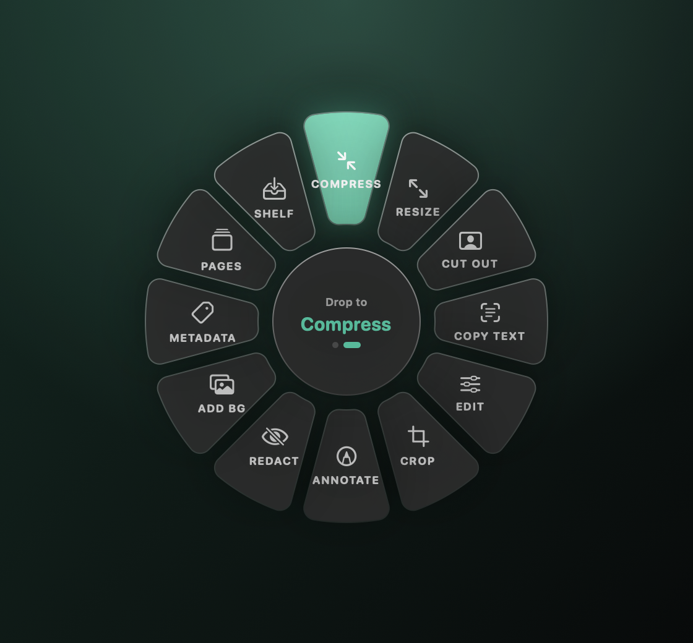
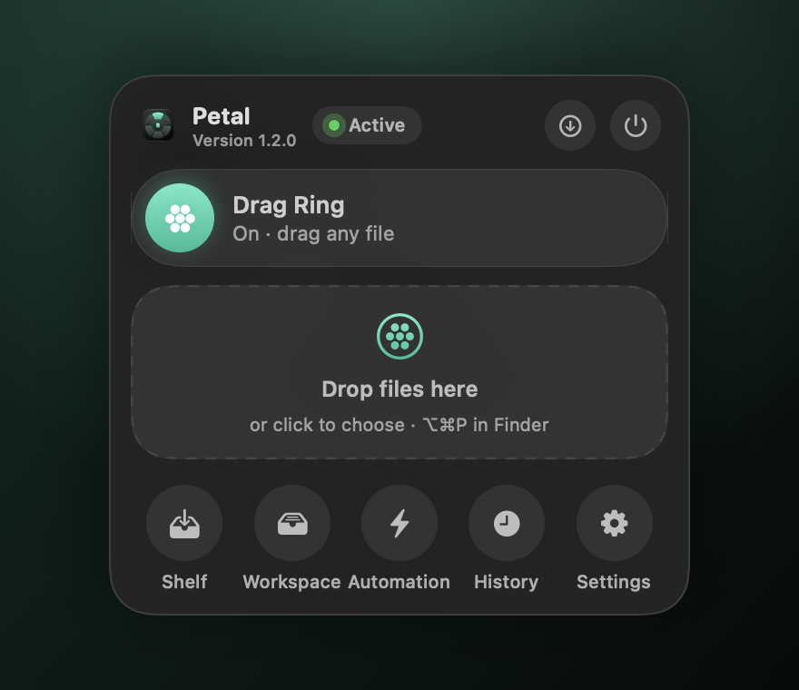
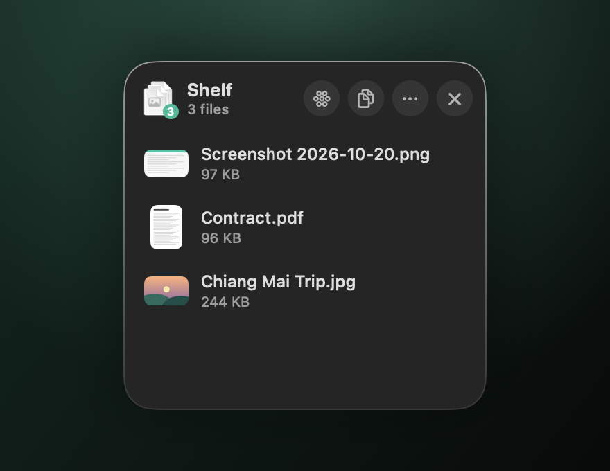
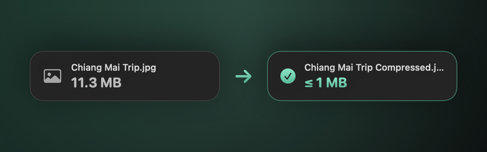

# Petal

<p align="center"></p>

<p align="center">
  <a href="https://github.com/AImunich20/petal-releases/releases/latest/download/Petal.dmg"><b>⬇ Download Petal.dmg</b></a>
  · macOS 14+ · Apple silicon &amp; Intel · free, updates itself<br>
  Install guide with screenshots (Thai / English): <a href="site/README.md">site/README.md</a>
  · <a href="https://aimunich20.github.io/petal-releases/">website</a>
</p>

<p align="center">
  
  
</p>
<p align="center">
  
  
</p>

**Install:** open the DMG and drag Petal into Applications. The first time you open it, macOS may block it;
go to System Settings → Privacy &amp; Security → **Open Anyway** (once). Petal lives in the menu bar (✿).

**Petal** is a macOS menu bar utility that opens a radial "file ring" whenever you drag a file.
Drop the file on a petal to convert it or open a quick editor. A Manager window handles
batches, history and settings. Results are saved as new files and never overwrite the original.

```
Page 001.pdf  ──JPG──▶  Page 001.jpg  ──Crop──▶  Page 001 Cropped.jpg  ──Add BG──▶  Page 001 Cropped With Background.png
```

## The ring

Start dragging any file from Finder or the Desktop and the ring fades in beside the pointer.

| Convert ring | Tools ring |
| --- | --- |
| PNG · WEBP · HEIC · JPG · AVIF · TIFF · BMP · PDF · DOCX | Compress · Resize · Cut Out · Copy Text · Edit · Crop · Annotate · Redact · Add BG · Metadata · GIF / Video · Merge PDF · Pages · Split PDF · PDF Tools |

- **Hub:** shows the file size. Hold the dragged file over the hub for about half a second to switch between the Convert and Tools rings.
- Images, PDFs and videos open on the **Tools** ring; documents open on **Convert**.
- The ring only shows petals that work for the dragged files, so it stays small.
- Select files in Finder and press **⌥⌘P** to open the ring for them.
- **Menu bar → Open Files…** opens the same ring without dragging. You click the petals instead.

### Conversions

| From | To |
| --- | --- |
| Images | Any image format this Mac can encode, plus PDF |
| PDF | Images (one per page, rendered at 300 dpi) or DOCX (text) |
| DOCX / RTF / TXT / HTML | PDF (US Letter) or DOCX |

The encoders come from ImageIO, so the options depend on the macOS version. Stock macOS
reads WebP but can't write it, so the WEBP petal stays dimmed unless a WebP encoder is
available.

### Tools

| Tool | What it does | Output |
| --- | --- | --- |
| Compress | Re-encodes images (JPEG/HEIC) or optimizes PDF images; keeps it only if smaller | `… Compressed` |
| Resize | Scales every image by a percentage or to fit a maximum side (never upscales when fitting) | `… Resized` |
| Metadata | Lists EXIF / GPS / TIFF data, warns about location, removes it all | `… Clean` |
| Edit | Brightness, contrast, saturation, exposure, rotate, flip | `… Edited` |
| Annotate | Pen and highlighter with colors and sizes | `… Annotated` |
| Add BG | Gradient, solid or image backdrop with padding, corners, shadow, ratio (Auto, 1:1, 16:9, 4:5) | `… With Background.png` |
| Crop | Drag handles, aspect presets (Free, 1:1, 16:9, 9:16, 4:3, 3:4), exact W × H in pixels | `… Cropped` |
| Redact | Draw boxes to black out or pixelate | `… Redacted` |
| Merge PDF | Combines two or more images and PDFs, in order, into one PDF | `… Merged.pdf` |
| Pages | Page grid: drag to reorder, rotate, delete, add pages from other PDFs or images, extract the selection (⌘A, ⌫, ⌘[ / ⌘], ⌘S) | `… Edited.pdf`, `… Extract.pdf` |
| Split PDF | Every page, every N pages, or ranges like `1-3, 5, 8-` | `… Split/… Pages 1-3.pdf` |
| Cut Out | Removes the background of a photo (Vision subject lifting) | `… No Background.png` |
| Copy Text | On-device OCR (Thai, English and more) for images and scanned PDFs; copies it and shows it | `… Text.txt` (on Save) |
| GIF / Video | Two or more images → looping GIF or H.264 slideshow | `… Animation.gif`, `… Slideshow.mp4` |
| PDF Tools | Password lock / unlock, diagonal watermark, page numbers, drawn signature placed by dragging | `… Locked`, `… Unlocked`, `… Watermarked`, `… Numbered`, `… Signed` |

Compress also shrinks videos (Settings → Quality → Video compression: Smallest / 720p / 1080p).

## Compress to a size

Settings → **Compress to** (or the arrow on the Workspace's Compress button) aims for "under 200 KB / 500 KB /
1 MB / 2 MB / 5 MB / 10 MB". Images become JPEG at the best quality that fits, shrinking only if needed; PDFs
are optimized first and turned into page images only when that isn't enough. The Compress petal then reads
**≤ 1 MB**. Links: `petal://run?action=compress-2mb&path=…`.

## Shelf

A floating panel at the edge of the screen for parking files. Drop files on it (or on the Shelf petal), drag
them out one at a time or all at once from the stack icon, or copy them for pasting into Mail or LINE. New
results land there too (turn off in the ⋯ menu or Settings). Open it from the menu bar panel or `petal://shelf`.

## Control panel

Click the petal icon in the menu bar for a Control Center–style panel. Its title bar has
**Check for Updates** and **Quit**. Below that: pause or resume the drag ring, drop files to
bloom the ring right there, open the Shelf, jump to Workspace / Automation / History / Settings, and drag
recent results straight into other apps.

## Automation

- **Watch folders** (Manager → Automation): new files in a folder are compressed, converted,
  read (OCR) or cut out automatically. Petal never re-processes its own results.
- **⌥⌘P** opens the ring for the files selected in Finder.
- **Finder Quick Actions:** right-click files → Services / Quick Actions → *Petal: Compress*,
  *Copy Text*, *Remove Background*, *Convert to JPG/PDF*, *Merge*, *Split*, *Rename*…
- **Links for Shortcuts and scripts:** `petal://ring`, `petal://run?action=compress&path=/path/file.jpg`
  (actions: any tool name, `convert-<format>`, `pages`, `split`, `merge`, `rename`, `workspace`).

## Folder access and language

The welcome window (and Settings → Folder Access) asks once for Desktop, Documents, Downloads,
Pictures and iCloud Drive, and links to Full Disk Access for everything else. Builds signed with
the same identity keep these permissions across updates (see Build). Settings → Language
switches between English and Thai (`Resources/th.lproj`, generated by `scripts/l10n/th.py`;
`scripts/extract-strings.py --check` lists untranslated strings).

## Manager

Open it from the menu bar (**Open Manager**, ⌘M), by clicking the Dock icon, or by opening
files with the app from Finder (**Open With → Petal**).

- **Workspace:** drop files or whole folders, then Convert, Compress, Resize, Remove Metadata
  (in bulk), open an editor or the ring. The **PDF** menu merges files (in list order), opens
  the page organizer, or splits PDFs into single pages. Drag rows or use **Sort** to set the
  order; right-click for Organize Pages, Split, or Move to Trash. Actions apply to the
  selection, or to every file when nothing is selected.
- **History:** every result, searchable, with Open / Reveal, "Add results to Workspace",
  and clean-up of entries whose files are gone.
- **Settings:** launch at login, Dock icon, reveal in Finder after saving, ring on/off and
  drag distance, save next to the original or into a chosen folder, JPG/HEIC and compression
  quality, PDF render resolution.

## Install

Download from the [download page](https://aimunich20.github.io/petal-releases/) (or
[Releases](https://github.com/AImunich20/petal-releases/releases)), open the DMG and drag
**Petal** onto **Applications**. The build isn't notarized, so the first time macOS blocks
it: System Settings → Privacy & Security → **Open Anyway** (older macOS: Control-click →
**Open**). After that, updates install by themselves.

## Build & run

Requires macOS 14+ and Xcode 16+ or the Command Line Tools (Swift 6 toolchain).

```sh
swift run Petal          # run from the terminal
scripts/test.sh                 # core unit tests (Swift Testing, works with just the CLT)
scripts/build-app.sh            # creates build/Petal.app (with icon)
scripts/build-dmg.sh            # creates build/Petal-1.0.0.dmg
UNIVERSAL=1 VERSION=1.1.0 scripts/build-dmg.sh   # Apple silicon + Intel
```

Set `SIGN_IDENTITY="Developer ID Application: …"` to sign with a real certificate, and
`NOTARY_PROFILE=…` to notarize (see the top of `scripts/build-dmg.sh`). Without one, the
build uses a self-signed **Petal Code Signing** identity if it's in the login keychain (so
folder permissions survive updates), otherwise an ad-hoc signature. The DMG window is styled
with `dmgbuild` (installed into `.build/dmgvenv` on first use). `scripts/publish-site.sh`
publishes the download page in `site/` to GitHub Pages.

## Updates (Sparkle)

Petal checks for updates daily and from **Settings → Updates** or **Updates** in the control
panel. The feed is
`https://github.com/AImunich20/petal-releases/releases/latest/download/appcast.xml`, so
releases go to a separate **public** repo (`AImunich20/petal-releases`); override with
`FEED_URL=…`, or `FEED_URL=` to build without updates.

Updates are signed with an EdDSA key. The public key is in `scripts/build-app.sh`; the
private key is in the login keychain of the Mac that created it (account `petal`). Back it
up — without it you can't ship updates to existing installs:

```sh
.build/artifacts/sparkle/Sparkle/bin/generate_keys --account petal -x petal-private-key   # export
.build/artifacts/sparkle/Sparkle/bin/generate_keys --account petal -f petal-private-key   # import elsewhere
```

To ship a version: write `release-notes/<version>.md`, commit (the build number is the
commit count), then

```sh
VERSION=1.1.0 scripts/release.sh             # build, sign, update appcast.xml
VERSION=1.1.0 PUBLISH=1 scripts/release.sh   # …and create the GitHub release
```

and commit the updated `appcast.xml`.

With only the Command Line Tools, the macOS 27 SDK can't compile the app (SwiftUI's
`@State` macro plugin ships with Xcode), so `build-app.sh` builds against an older
installed SDK. To do the same by hand, prefix commands with
`SDKROOT=/Library/Developer/CommandLineTools/SDKs/MacOSX26.5.sdk`. For tests with only the
Command Line Tools, run `scripts/test.sh`: it builds only the core (`CORE_ONLY=1`) and passes
the Swift Testing macro plugin explicitly.

You can also open `Package.swift` in Xcode and run the `Petal` scheme.

The app watches drags with a global mouse monitor. This doesn't need the Accessibility
permission because it never reads keystrokes.

## Layout

```
Sources/FileAppCore/     conversion, compression and image processing (no UI); unit tested
Sources/Petal/
  App/                   entry point, menu bar, drag detection, settings, action routing
  Manager/               Manager window: workspace, automation, history, settings, about
  Ring/                  the radial menu panel, its model and drop handling
  Editors/               Crop, Add BG, Edit, Annotate, Redact, Resize, Metadata, Pages, PDF Tools,
                         GIF / Video, Rename and Copy Text windows
  UI/                    theme, shared controls, control panel, onboarding, progress toast
Resources/th.lproj/      Thai strings (generated by scripts/l10n/th.py)
site/                    download page (GitHub Pages of the releases repo)
Tests/FileAppCoreTests/
scripts/                 build-app.sh, build-dmg.sh, release.sh, test.sh, publish-site.sh, make-icon.swift
release-notes/           notes shown in the update dialog
appcast.xml              Sparkle update feed
```
